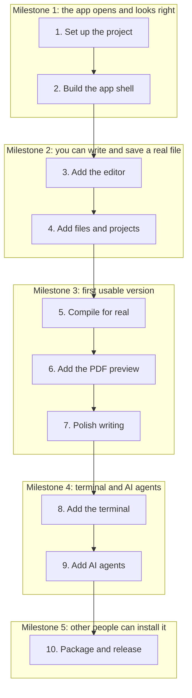

# Parse build process

Ten stages from an empty folder to a released LaTeX editor, grouped into five milestones.

Stack: Tauri, React, TypeScript, Tailwind and Rust.

Rules:

- Work through the stages in order.
- Don't start a stage until the previous stage's "Done when" check passes.
- Each "Done when" check is a good point to commit.
- Try a quick version of stage 5 right after stage 1, because real compiling is the riskiest part.

## Flow

## Milestone 1: the app opens and looks right

### Stage 1: Set up the project

Area: Setup

- Install Node, Rust, Xcode command line tools and a TeX distribution
- Create the app with the Tauri react-ts template
- Add Tailwind through its Vite plugin
- Start a Git repository and make your first commit

Done when: `npm run tauri dev` opens a window.

### Stage 2: Build the app shell

Area: Frontend

- Copy Leafy tokens into CSS variables and map them in Tailwind
- Bundle IBM Plex and Material Symbols so they work offline
- Lay out the top bar, toolbar, sidebar, panes, terminal and status bar
- Make panes resizable and save the theme and sizes

Done when: the empty layout matches the design in light and dark.

## Milestone 2: you can write and save a real file

### Stage 3: Add the editor

Area: Frontend

- Add CodeMirror 6 with the stex LaTeX mode
- Theme it with Leafy tokens
- Wire toolbar buttons to wrap the selection or insert snippets
- Add undo, shortcuts, find and replace, bracket matching and line and word counts

Done when: every toolbar button edits the text and undo reverses it.

### Stage 4: Add files and projects

Area: Frontend + Rust

- Open a folder with the Tauri dialog plugin and list its files in Rust
- Add tabs, create, rename and delete
- Autosave after a short pause and show the real save state
- Watch for outside changes with the notify crate
- Build the outline from the document's section commands

Done when: you can close the app, reopen it and carry on with nothing lost.

## Milestone 3: first usable version

### Stage 5: Compile for real

Area: Rust

- Write a Rust command that runs latexmk in a build folder
- Stream progress to React with Tauri events
- Cancel a running compile when a newer one starts
- Parse the log into file, line, severity and message
- Show errors in the editor gutter and link them to their lines

Done when: a broken document shows the right line and a fixed one produces a PDF.

### Stage 6: Add the PDF preview

Area: Frontend

- Render the PDF with pdfjs-dist, drawing only visible pages
- Add zoom, fit to width, page numbers and download
- Recompile after a pause when Auto-compile is on
- Keep the scroll position after each recompile
- Add click from PDF to source and back with SyncTeX

Done when: a long document updates smoothly without jumping.

### Stage 7: Polish writing

Area: Frontend

- Add command and environment autocomplete
- Complete citations from .bib files and labels from the project
- Add spell check that skips commands and math
- Add project templates and pasted or dropped images

Done when: you can write a full paper in Parse without another tool.

## Milestone 4: terminal and AI agents

### Stage 8: Add the terminal

Area: Frontend + Rust

- Run a shell in Rust with portable-pty
- Display it with @xterm/xterm and pass keystrokes and output through Tauri
- Handle resizing, several tabs and shutting down processes

Done when: latexmk and full-screen tools like vim work inside it.

### Stage 9: Add AI agents

Area: Frontend + Rust

- Store the API key in the system keychain from Rust
- Make model calls in Rust and stream replies to the agent tab
- Give agents limited tools: read file, read errors, propose edit
- Show proposed edits as a diff to accept or reject
- Let people connect their own agent command

Done when: no agent can change a file without approval.

## Milestone 5: other people can install it

### Stage 10: Package and release

Area: Setup

- Test on a clean machine, including one with no TeX installed
- Build installers with `npm run tauri build`
- Sign and notarize for macOS, and sign for Windows
- Add the Tauri updater plugin
- Set up GitHub Actions to build each release

Done when: someone else can install it, open a project and receive an update.
